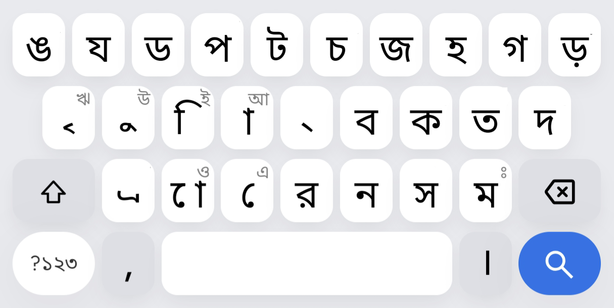
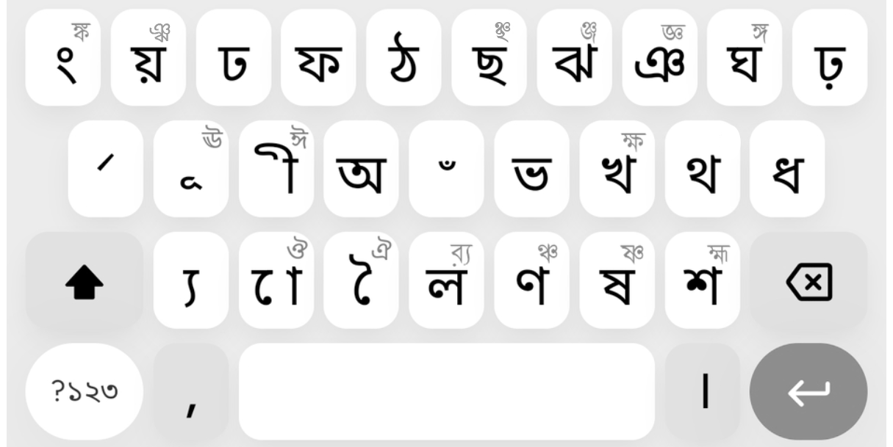

# Bangla BSTI Mobile Keyboard Layout

> Bangla BSTI Mobile layout based on National Keyboard Standard (Revised) BDS 1738:2018, enhanced with usability improvements for smooth mobile typing.

**Bangla BSTI Mobile** is an optimised Bengali mobile keyboard layout derived from the National Keyboard Standard (Revised) **BDS 1738:2018** (BSTI). While preserving the canonical placement of standard consonants, this layout introduces practical mobile-first adaptations tailored for touchscreens—including intuitive long-press access to full vowels, direct high-frequency conjunct overlays on the Shift layer, and streamlined long-press behaviour.

---

## 🖼️ Layout Overview

| Normal Mode | Shift Mode |
| :---: | :---: |
|  |  |

---

## 🚀 Key Usability Enhancements

1. **Intuitive Vowels via Long-Press on Kar Signs:**
   * Full independent vowels can be directly entered by long-pressing their corresponding vowel signs (kar). For example, long-pressing `া` produces `আ`, `ি` produces `ই`, `ে` produces `এ`, and `ো` produces `ও`.
2. **Direct High-Frequency Conjunct Overlays:**
   * Reduces repetitive input sequences involving the Hasanta (`্`). Ubiquitous ligatures (e.g. ঙ্ক, ঞ্চ, ঞ্জ, জ্ঞ, ঙ্গ, ক্ষ, ষ্ণ, হ্ম, র্য) are directly mapped to long-press overlays on the Shift layer.
3. **Dedicated O-Kar (`ো`) and AU-Kar (`ৌ`) Placement:**
   * To improve efficiency, the base layer features `ো` directly on the `X` key (with `ও` on long-press), whilst the Shift layer provides `ৌ` on `Shift + X` (with `ঔ` on long-press).
4. **Refined Long-Press Logic:**
   * Khanda-Ta (`ৎ`) is retained exclusively as a long-press option on **'ত' (K)**. The redundant duplicate on **'থ' (Shift + K)** has been removed to reduce cognitive clutter.

---

## ⌨️ Key Mapping & Unicode Specification

### 1. Top Row (Q – P)

| Key | Normal | Unicode | Shift | Unicode | Shift Overlay / Conjunct | Unicode Sequence | Description |
| :---: | :---: | :---: | :---: | :---: | :---: | :--- | :--- |
| **Q** | ঙ | `U+0999` | ং | `U+0982` | **ঙ্ক** | `U+0999 U+09CD U+0995` | NGA / Anusvara / NG-KA |
| **W** | য | `U+09AF` | য় | `U+09DF` | — | — | YA / YYA |
| **E** | ড | `U+09A1` | ঢ | `U+09A2` | — | — | DDA / DDHA |
| **R** | প | `U+09AA` | ফ | `U+09AB` | — | — | PA / PHA |
| **T** | ট | `U+099F` | ঠ | `U+09A0` | — | — | TTA / TTHA |
| **Y** | চ | `U+099A` | ছ | `U+099B` | **ঞ্চ** | `U+099E U+09CD U+099A` | CA / CHA / NYA-CA |
| **U** | জ | `U+099C` | ঝ | `U+099D` | **জ্ঞ** | `U+099C U+09CD U+099E` | JA / JHA / JA-NYA |
| **I** | হ | `U+09B9` | ঞ | `U+099E` | **ঞ্জ** | `U+099E U+09CD U+099C` | HA / NYA / NYA-JA |
| **O** | গ | `U+0997` | ঘ | `U+0998` | **ঙ্গ** | `U+0999 U+09CD U+0997` | GA / GHA / NG-GA |
| **P** | ড় | `U+09DC` | ঢ় | `U+09DD` | — | — | RRA / RRHA |

---

### 2. Home Row (A – L)

| Key | Normal | Unicode | Shift | Unicode | Long-Press / Overlay | Unicode | Description |
| :---: | :---: | :---: | :---: | :---: | :---: | :---: | :--- |
| **A** | ৃ | `U+09C3` | ঽ | `U+09BD` | **ঋ** (Normal) | `U+098B` | Vocalic R Sign / Avagraha / Vocalic R |
| **S** | ু | `U+09C1` | ূ | `U+09C2` | **উ** (Normal) / **ঊ** (Shift) | `U+0989` / `U+098A` | Vowel Sign U, UU & Full Letters |
| **D** | ি | `U+09BF` | ী | `U+09C0` | **ই** (Normal) / **ঈ** (Shift) | `U+0987` / `U+0988` | Vowel Sign I, II & Full Letters |
| **F** | া | `U+09BE` | অ | `U+0985` | **আ** (Normal) | `U+0986` | Vowel Sign AA / Letter A / Letter AA |
| **G** | ্ | `U+09CD` | ্‌ | `U+09CD` | — | — | Sign Virama (Hasanta) |
| **H** | ব | `U+09AC` | ভ | `U+09AD` | — | — | BA / BHA |
| **J** | ক | `U+0995` | খ | `U+0996` | **ক্ষ** (Shift) | `U+0995 U+09CD U+09B7` | KA / KHA / KA-SSA |
| **K** | ত | `U+09A4` | থ | `U+09A5` | **ৎ** (Normal long-press) | `U+09CE` | TA / THA (ৎ removed from থ) |
| **L** | দ | `U+09A6` | ধ | `U+09A7` | — | — | DA / DHA |

---

### 3. Bottom Row (Z – M)

| Key | Normal | Unicode | Shift | Unicode | Long-Press / Overlay | Unicode Sequence | Description |
| :---: | :---: | :---: | :---: | :---: | :---: | :--- | :--- |
| **Z** | ্য | `U+09CD U+09AF` | ্য | `U+09CD U+09AF` | — | — | Ya-phala (Subjoined Ya) |
| **X** | ো | `U+09CB` | ৌ | `U+09CC` | **ও** (Normal) / **ঔ** (Shift) | `U+0993` / `U+0994` | Vowel Sign O, AU & Full Letters |
| **C** | ে | `U+09C7` | ৈ | `U+09C8` | **এ** (Normal) / **ঐ** (Shift) | `U+098F` / `U+0990` | Vowel Sign E, AI & Full Letters |
| **V** | র | `U+09B0` | ল | `U+09B2` | **র্য** (Shift) | `U+09B0 U+09CD U+09AF` | RA / LA / Ref-Ya |
| **B** | ন | `U+09A8` | ণ | `U+09A3` | **ঞ্চ** (Shift alt) | `U+099E U+09CD U+099A` | NA / NNA / NYA-CA |
| **N** | স | `U+09B8` | ষ | `U+09B7` | **ষ্ণ** (Shift) | `U+09B7 U+09CD U+09A3` | SA / SSA / SSA-NNA |
| **M** | ম | `U+09AE` | শ | `U+09B6` | **ঃ** (Normal) / **হ্ম** (Shift) | `U+0983` / `U+09B9 U+09CD U+09AE` | MA / SHA / Visarga / HA-MA |

---

## 🧩 Direct Conjunct Reference Table

| Conjunct | Canonical Decomposition | Unicode Codepoint Sequence | Shift Key Position |
| :---: | :--- | :--- | :---: |
| **ঙ্ক** | ঙ + ্ + ক | `U+0999` + `U+09CD` + `U+0995` | `Q` (long-press on ং) |
| **ঞ্চ** | ঞ + ্ + চ | `U+099E` + `U+09CD` + `U+099A` | `Y` (ছ) or `B` (ণ) |
| **জ্ঞ** | জ + ্ + ঞ | `U+099C` + `U+09CD` + `U+099E` | `U` (long-press on ঝ) |
| **ঞ্জ** | ঞ + ্ + জ | `U+099E` + `U+09CD` + `U+099C` | `I` (long-press on ঞ) |
| **ঙ্গ** | ঙ + ্ + গ | `U+0999` + `U+09CD` + `U+0997` | `O` (long-press on ঘ) |
| **ক্ষ** | ক + ্ + ষ | `U+0995` + `U+09CD` + `U+09B7` | `J` (long-press on খ) |
| **ষ্ণ** | ষ + ্ + ণ | `U+09B7` + `U+09CD` + `U+09A3` | `N` (long-press on ষ) |
| **হ্ম** | হ + ্ + ম | `U+09B9` + `U+09CD` + `U+09AE` | `M` (long-press on শ) |
| **র্য** | র + ্ + য | `U+09B0` + `U+09CD` + `U+09AF` | `V` (long-press on ল) |

---

## 📝 Independent Vowel Input Methods

Independent vowels can be typed smoothly using either intuitive long-press shortcuts or canonical combinations:

* **অ:** Directly via `Shift + F` (`U+0985`)
* **আ:** Long-press on `f` (`া`) *(or `Shift + F` + `f`)* (`U+0986`)
* **ই:** Long-press on `d` (`ি`) *(or `Shift + F` + `d`)* (`U+0987`)
* **ঈ:** Long-press on `Shift + D` (`ী`) *(or `Shift + F` + `Shift + D`)* (`U+0988`)
* **উ:** Long-press on `s` (`ু`) *(or `Shift + F` + `s`)* (`U+0989`)
* **ঊ:** Long-press on `Shift + S` (`ূ`) *(or `Shift + F` + `Shift + S`)* (`U+098A`)
* **ঋ:** Long-press on `a` (`ৃ`) *(or `Shift + F` + `a`)* (`U+098B`)
* **এ:** Long-press on `c` (`ে`) *(or `Shift + F` + `c`)* (`U+098F`)
* **ঐ:** Long-press on `Shift + C` (`ৈ`) *(or directly on Shift)* (`U+0990`)
* **ও:** Long-press on `x` (`ো`) *(or `Shift + F` + `x`)* (`U+0993`)
* **ঔ:** Long-press on `Shift + X` (`ৌ`) *(or directly on Shift)* (`U+0994`)

---

## 📄 Licence

This layout specification and documentation are published under the **[Creative Commons Attribution 4.0 International Licence (CC BY 4.0)](LICENSE)**.

You are free to share, adapt, and integrate this layout across all platforms (such as Gboard, OpenBoard, or bespoke IME implementations), provided that appropriate attribution is given to **Bangla** as the original project.
